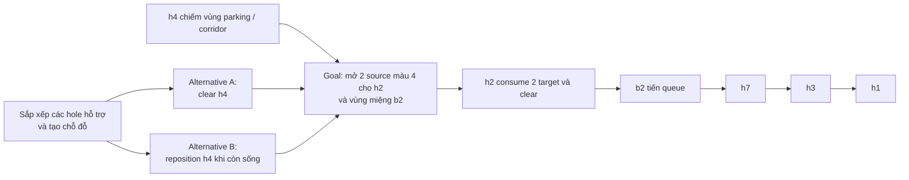
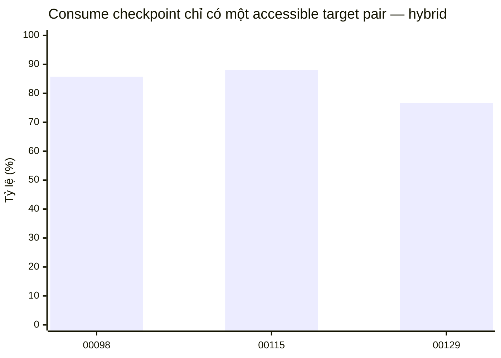
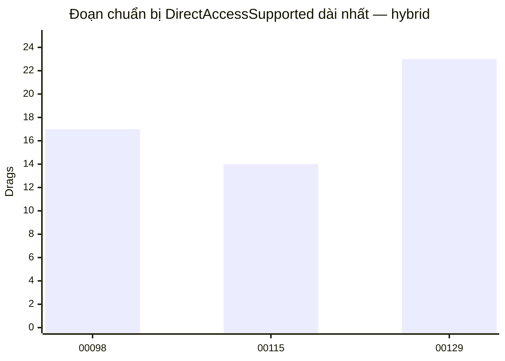
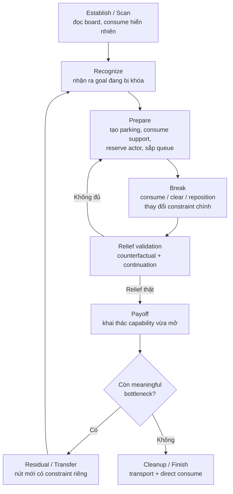

# Đặc tả Difficulty & Progression cho Generate VIPPRO

## Tóm tắt điều hành

Qua việc đọc source, tài liệu thiết kế, ba level gốc, harness nghiên cứu và dữ liệu replay hiện có, kết luận quan trọng nhất là: **Generate VIPPRO chưa nên chuyển sang viết generator hoặc khóa một công thức Hard production ngay lúc này**. Chính trạng thái dự án ngày 15/10/2026 xác định công việc hiện tại là kiểm chứng sâu các level gốc; các thử nghiệm alternative mới của bước đầu tiên vẫn chưa được thực hiện. Hướng đã thống nhất là difficulty phải phản ánh **ràng buộc mà người chơi phải hiểu và phối hợp để phá bottleneck**, không phải tổng số drag, first-clear index hay solver runtime. 【Project: `Generate Docs/LEVELGEN_CURRENT_WORK.md`:5, 9–15, 40–87】【Project: `Generate Docs/LEVELGEN_DIFFICULTY.md`:5–7, 46–50】

**Việc cần làm ngay, theo thứ tự ưu tiên, là:**

1. Hoàn tất targeted search cho **Level00115**, trả lời ba câu hỏi mà `LEVELGEN_CURRENT_WORK.md` đã đặt ra: có mở h2/b2 trước khi clear h6 hay không; ai thật sự phải nhường chỗ cho h4; và ở b2 có thể consume rồi park hole còn sống thay vì clear hay không. Kết quả phải phân biệt `Found`, `NotFoundWithinBudget` và `ProvedImpossibleWithinScope`, tuyệt đối không biến timeout thành chứng minh bất khả thi. 【Project: `Generate Docs/LEVELGEN_CURRENT_WORK.md`:44–71】

2. Chuẩn hóa một `BottleneckRecord` có machine-readable schema: goal bị chặn, constraint, dependency, alternative break, relief, continuation, residual bottleneck và evidence class. Sau đó áp cùng một analyzer cho **Level00098 và Level00129**. Đây chính là bước còn thiếu để biến các quan sát hiện nay thành một đặc tả difficulty có thể implement. 【Project: `Generate Docs/LEVELGEN_CURRENT_WORK.md`:58–81】

3. Chỉ sau hai bước trên mới implement metric extractor cho inference, meaningful branching, forcedness, lookahead, strategy uniqueness và human-heuristic gap; sau đó mới hiệu chỉnh công thức điểm bằng human playtest. Công thức đề xuất trong tài liệu này vì vậy là **Difficulty Model v0**, đủ cụ thể để engineers implement nhưng **chưa được phép trở thành production gate trước calibration**. Điều này giữ đúng cảnh báo hiện tại của dự án rằng chưa có weighted score hoặc Hard threshold đã được chứng minh. 【Project: `Generate Docs/LEVELGEN_DIFFICULTY.md`:7, 89–112】【Project: `Generate Docs/LEVELGEN_PRESET.md`:61–72】

Phân tích ba mẫu cũng cho thấy vì sao cần thay đổi đơn vị đánh giá. **Level00115** có bottleneck hình học/parking rất rõ nhưng tồn tại ít nhất hai cách phá: clear h4 hoặc dời h4 khi nó còn sống. **Level00098** có cấu trúc queue liên kết thành một chu trình, buộc một số hole phải tiếp tục sống và quay sang queue khác. **Level00129** còn có hai cụm cyclic queue và một queue dài sáu phần tử với cùng hole xuất hiện lại nhiều lần. Những đặc điểm này thể hiện **coordination structure**, trong khi tổng drag thay đổi rất mạnh theo mode solver và do đó không phải thước đo ổn định cho cognitive difficulty. 【Project: `Generate Docs/LEVELGEN_ORIGINAL_BOTTLENECKS.md`:7–11, 38–89】【Project: `Levels/Level00098.json`:1】【Project: `Levels/Level00129.json`:1】【Project: `Generate Docs/research/access-focus-hybrid.json`; `access-focus-improved.json`】

Hướng metric này có cơ sở bên ngoài dự án: nghiên cứu Sudoku cho thấy difficulty của các chiến thuật suy luận liên quan đến số constraint mà suy luận phải đồng thời phụ thuộc vào; nghiên cứu relational reasoning độc lập cũng thấy nhiều premise và quan hệ đa chiều làm nhiệm vụ khó hơn. Các thí nghiệm Sudoku khác đã dùng **số bước logic tối thiểu** để phân bậc difficulty và thấy phân bậc đó gần với difficulty chủ quan của người tham gia. Đây là lý do hợp lý để VIPPRO đo inference depth và relational complexity thay vì tổng thao tác, dù các nghiên cứu đó **không phải bằng chứng hiệu chỉnh trực tiếp cho gameplay VIPPRO**. citeturn8search0turn5view2turn7search5

**Đề xuất kiến trúc cuối cùng:** Difficulty và Quality phải là hai trục khác nhau. `DifficultyScore` đo lượng suy luận, lookahead, lựa chọn và phối hợp để phá bottleneck. `ExperienceQuality` đo satisfaction, elegance và fairness. Một level có thể khó nhưng tệ; hoặc vừa phải nhưng cực kỳ đẹp. Không nên cộng satisfaction/fairness vào DifficultyScore để “bù điểm”.

## Cơ sở bằng chứng và hiện trạng dự án

### Thứ tự ưu tiên artifact

| Mức | Artifact | Vai trò chuẩn |
|---|---|---|
| Normative | `LEVELGEN_CORE.md` | Gameplay invariants, scope sản phẩm, solvability/replay requirements |
| Normative | `LEVELGEN_CURRENT_WORK.md` | Nguồn chuẩn về **việc phải làm hiện tại** và trạng thái nghiên cứu |
| Normative | `LEVELGEN_DIFFICULTY.md` | Định nghĩa hiện hành về bottleneck-oriented difficulty |
| Normative | `LEVELGEN_PROGRESSION.md` | Định nghĩa progression nội tại một level |
| Normative | `LEVELGEN_PRESET.md` | Scope 7×8, mechanic, validity và preset constraints |
| Primary empirical | `Levels/Level00098.json`, `Level00115.json`, `Level00129.json` | Ground truth cấu trúc ba level |
| Primary empirical | `LEVELGEN_ORIGINAL_BOTTLENECKS.md` | Phân tích chi tiết Level00115 đã được review vào project |
| Primary empirical | `research/bottleneck-original-00115.json` | Replay snapshots của hai witness 00115 |
| Primary empirical | `research/access-focus-*.json` | Frozen-phase access, footprint-shadow và preparation telemetry |
| Research code | `ProgressionStudy/BottleneckStudy.cs`, `AccessStudy.cs` | Cách dữ liệu hiện tại được sinh |
| Correctness | `IndependentSolver/Api.cs` | Source solver hiện tại, algorithm version 3.0.0 |
| Correctness | `Verification/V42Reference` + replay harness | Independent gameplay verification |
| Utility | `Verification/GeneratorOracle.cs` | JSONL solve/replay/simulate bridge, nhưng hiện có metadata/fixture cần sửa |

Nguồn dự án tự quy định rằng CORE và PRESET giữ invariant, còn CURRENT_WORK quản lý trạng thái; research JSON chỉ là evidence và không tự trở thành kết luận difficulty. 【Project: `Generate Docs/LEVELGEN_CURRENT_WORK.md`:5, 28–38, 89–95】【Project: `Generate Docs/research/README.md`:3–16, 31–38】

### Những gì đã được chứng minh và những gì chưa

`Level00115` hiện có hai plan được replay bằng V42 reference độc lập. Trong hybrid, clear h4 ở drag 108 lập tức mở hai source màu 4 cuối cho h2; shadow diagnostic giữ lại footprint h4 làm hai target đó mất access. Trong improved, chỉ cần dời h4 từ vùng dưới phải sang anchor bên trái ở drag 81, không consume và không clear, hai target tương tự cũng trở nên accessible. Do đó bottleneck hợp lý là **“mở h2/lower-right và chuỗi b2”**, không phải rule “phải clear h4”. 【Project: `Generate Docs/LEVELGEN_ORIGINAL_BOTTLENECKS.md`:38–56, 85–89】

Đây là khác biệt thiết kế rất quan trọng:



Điều chưa được chứng minh là h6 có bắt buộc phải clear trước vùng h2/b2 hay không, h4 có bắt buộc phải di chuyển trong mọi strategy hay không, task hỗ trợ nào là thật sự necessary, và minimum reasoning/lookahead là bao nhiêu. Harness hiện tại chỉ solve hai mode rồi replay; `research/README.md` nói rõ nó **chưa có targeted search trả lời các câu hỏi mới**. 【Project: `Generate Docs/LEVELGEN_ORIGINAL_BOTTLENECKS.md`:79–83】【Project: `Generate Docs/research/README.md`:18–38】【Project: `Generate Docs/research/ProgressionStudy/BottleneckStudy.cs`:11–36】

Ngoài ra, môi trường phân tích hiện tại không có runtime `dotnet`, nên bản nghiên cứu này không giả vờ rằng các targeted experiments mới đã được chạy. Các số liệu bên dưới được tái phân tích từ level JSON, shape catalog và research JSON đã tồn tại.

### Solver và verification phải được xem là oracle correctness, không phải oracle human difficulty

`IndependentSolver/Api.cs` khai báo `algorithmVersion = "3.0.0"` và với level classic, entry policy thử legacy/baseline trước rồi có thể restart bằng improved search sau state budget 10.000. Chính vì search policy khác nhau, plan được tìm thấy có thể khác đáng kể; project cũng nói solver không cam kết lời giải ngắn nhất. 【Project: `IndependentSolver/Api.cs`:14–25, 45–50, 98–128】【Project: `docs/SOLVER_ALGORITHM.md`:11–25, 39–41】

Điều này phù hợp với nghiên cứu PCG Sokoban: có thể tạo puzzle “hard” theo metric của một specialized solver, nhưng đó trước hết là **solver hardness**, không tự động là human difficulty. Vì thế `expanded`, runtime hoặc search-tree size nên được lưu như telemetry/diagnostic, không đưa trực tiếp vào DifficultyScore của VIPPRO. citeturn5view4

Có hai vấn đề tooling nên sửa trước khi dùng oracle cho pipeline mới. `GeneratorOracle.cs` trả `version = "2.0.0"` trong `info`, trong khi source solver hiện tại báo 3.0.0; ngoài ra nó warm-up bằng `Levels/Level00001.json`, trong khi tài liệu verification cảnh báo corpus workspace hiện tại là corpus đã được chọn lọc và một số test/fixture cũ không còn đầy đủ. 【Project: `Verification/GeneratorOracle.cs`:9–28】【Project: `IndependentSolver/Api.cs`:15–18】【Project: `docs/VERIFICATION.md`:14–20】

## Phân tích ba level tham chiếu và bản chất của bottleneck

### So sánh metric hiện có

Các metric cấu trúc dưới đây được tính trực tiếp từ `Levels/*.json` kết hợp footprint trong `IndependentSolver/IO/HoleShapes.json`. “Ô trống ban đầu” ở đây là board cells không nằm trong hole footprint, board cat hoặc unique wall; nó chỉ là density diagnostic, **không đồng nghĩa simultaneous parking capacity**. Queue graph nối consumer của hai phần tử liên tiếp trong cùng box. 【Project: `Levels/Level00098.json`:1】【Project: `Levels/Level00115.json`:1】【Project: `Levels/Level00129.json`:1】【Project: `Generate Docs/research/README.md`:31–38】

| Metric | Level00098 | Level00115 | Level00129 |
|---|---:|---:|---:|
| Hole | 9 | 8 | 9 |
| Board cats | 21 | 16 | 18 |
| Box | 2 | 4 | 3 |
| Unique walls | 1 | 4 | 1 |
| Tổng hole footprint | 29/56 | 25/56 | 31/56 |
| Ô chưa bị hole/cat/wall chiếm ban đầu | 5 | 11 | 6 |
| Queue dài nhất | 4 | 3 | 6 |
| Hole xuất hiện ở >1 queue | 2 | 3 | 3 |
| SCC cyclic trong queue dependency | 1 SCC, 4 hole | Không có | 2 SCC, mỗi SCC 4 hole |
| Queue entries lặp lại cùng hole trong một box | 0 | 0 | 2 extra entries |
| Frozen initial consumer/source pairs | 5 | 3 | 4 |
| Hybrid: consume checkpoints có đúng 1 accessible pair | 85.7% | 88.0% | 76.7% |
| Hybrid: mean accessible pairs tại consume | 1.29 | 1.16 | 1.37 |
| Hybrid: đoạn `DirectAccessSupported` non-eat dài nhất | 17 drags | 14 drags | 23 drags |
| Hybrid plan | 86 drags | 113 drags | 122 drags |
| Improved plan | 135 drags | 95 drags | 189 drags |
| Minimal inference proof | **Unknown** | **Unknown** | **Unknown** |
| Required lookahead | **Unknown** | **Unknown** | **Unknown** |
| Số strategy-equivalence solutions | **Unknown** | ≥2 cho lower-right goal | **Unknown** |
| Evidence bottleneck hiện tại | Proposed | Supported cục bộ | Proposed |

Các frozen-access metric là telemetry của `AccessStudy`: giữ các nhóm khác đứng yên và dừng ở first consumption. Project đã cảnh báo chúng không chứng minh full-level accessibility hoặc difficulty. 【Project: `Generate Docs/research/README.md`:11–16, 31–38】

Hai chart sau chỉ mô tả telemetry hiện có, không phải difficulty ranking:





Nguồn hai biểu đồ: `research/access-focus-hybrid.json`, các trường `events[].beforeTargetPairs` và `preparationSegments[]`; giới hạn phép đo được mô tả tại `research/README.md`. 【Project: `Generate Docs/research/README.md`:9–16, 31–38】

### Level00115: geometry/parking kết hợp queue-mouth

Ở 00115, bốn wall duy nhất chia board quanh cột giữa, trong khi h4 và h5 đều có footprint 4 cell nhưng khác shape. Ban đầu, trong frozen-phase chỉ h0, h1 và h5 có first consumption trực tiếp. Vùng dưới phải chứa hai target cuối của h2 tại `(4,0)` và `(6,0)`, đồng thời là khu vực của mouth b2 tại `(5,0)`. h4 có thể chiếm đúng vùng cần thiết này. 【Project: `Generate Docs/LEVELGEN_ORIGINAL_BOTTLENECKS.md`:13–40】

Hybrid cho thấy một **clear-based break**; improved cho thấy một **reposition-based break**. Đây là ví dụ mẫu về một bottleneck tốt: goal và blocker nhận diện được, break event có causal relief kiểm chứng bằng footprint shadow, và continuation ngay sau đó thực sự dùng capability vừa mở. 【Project: `Generate Docs/LEVELGEN_ORIGINAL_BOTTLENECKS.md`:42–77】

Queue của 00115 cũng cho thấy tại sao completion order và consume order phải tách biệt. Queue tiêu thụ theo các chuỗi:

- b0: `h1 → h5`
- b1: `h0 → h5`
- b2: `h7 → h3 → h1`
- b3: `h6 → h0`

Nhưng hole đứng trước không nhất thiết phải clear: chỉ consumption của queue head mới tiến queue. `h0` và `h1` trong witness improved có thể consume queue rồi vẫn sống. 【Project: `Levels/Level00115.json`:1】【Project: `Generate Docs/LEVELGEN_ORIGINAL_BOTTLENECKS.md`:69–77】

Do đó, feature quan trọng ở 00115 không phải “large hole must clear”, mà là:

> **Người chơi phải quản lý footprint và parking để mở một target region, đồng thời hiểu rằng queue progression phụ thuộc consume, còn footprint release phụ thuộc clear hoặc reposition.**

### Level00098: interlocked queue cycle và live-hole revisit

Từ JSON gốc, queue consumer graph của 00098 là:

`b0: h4 → h0 → h6 → h8`

`b1: h5 → h6 → h3 → h4`

Từ đó xuất hiện SCC `h4 → h0 → h6 → h3 → h4`. Cả h4 và h6 tham gia nhiều queue. Đây là một dấu hiệu cấu trúc mạnh hơn “queue dài”: một consumer phải thực hiện một vai trò ở một queue nhưng vẫn phải sống/di chuyển để hoàn tất vai trò ở một queue khác. 【Project: `Levels/Level00098.json`:1】

Research trace hiện có phù hợp với cấu trúc đó: trong hybrid, h4 consume ở một queue từ sớm nhưng vẫn sống, h6 tương tự; về cuối mới xuất hiện cascade completion. Tuy nhiên project chưa làm targeted dependency analysis cho 00098 theo standard mới, nên không được tuyên bố SCC này là **necessary reasoning core** cho mọi solution. Nó hiện là một hypothesis có sức thuyết phục cao cần được kiểm bằng strategy enumeration. 【Project: `Generate Docs/LEVELGEN_CURRENT_WORK.md`:73–81】【Project: `Generate Docs/research/access-focus-hybrid.json`】

### Level00129: queue return, hai dependency cycle và nhiều knot tiềm năng

129 có footprint total lớn nhất trong ba mẫu, nhưng điều đáng chú ý hơn nằm ở queue:

`b0: h4 → h0 → h3`

`b1: h3 → h2 → h0 → h4`

`b2: h1 → h5 → h8 → h7 → h1 → h1`

Queue graph tạo hai SCC độc lập, `{h4,h0,h3,h2}` và `{h1,h5,h8,h7}`. b2 còn yêu cầu cùng h1 xuất hiện ba lần trong queue, tức hai lần xuất hiện thêm sau lần đầu. Trong witness hybrid, một lần trở lại muộn của h1 có thể consume hai entry màu liên tiếp trong cùng drag. 【Project: `Levels/Level00129.json`:1】【Project: `Generate Docs/research/access-focus-hybrid.json`】

Đây là motif có khả năng tạo difficulty cao vì người chơi có thể phải **preserve một actor qua nhiều giai đoạn, quay lại một nguồn cũ và phối hợp hai knot**. Tuy nhiên chưa có bằng chứng human hoặc targeted-search để kết luận 129 khó hơn 98/115. Tài liệu hiện hành đã nhấn mạnh chính ba level này ban đầu được chọn với ảnh hưởng của total-drag ranking cũ và chưa được chứng nhận là ba level khó nhất. 【Project: `Generate Docs/LEVELGEN_CURRENT_WORK.md`:13–15】【Project: `Generate Docs/LEVELGEN_DIFFICULTY.md`:89–108】

### Các feature tạo nên một bottleneck có ý nghĩa

| Feature | Tác dụng lên Difficulty | Tác dụng lên Quality | Cách đo đề xuất |
|---|---|---|---|
| Nhiều constraint phải đồng thời hiểu | Tăng mạnh | Tốt nếu legible | Relational complexity |
| Dependency giữa nhiều support task | Tăng | Tốt nếu causal | Dependency graph |
| Parking/reservation cho live holes | Tăng | Tốt nếu player đọc được geometry | Simultaneous parking pressure |
| Queue cycle / revisit | Tăng coordination | Có thể elegant | SCC, revisit count |
| Hậu quả chỉ thấy sau nhiều event | Tăng lookahead | Có nguy cơ unfair | Required lookahead |
| Nhiều lựa chọn chiến lược hợp lý | Tăng branching | Tốt nếu có clue | Effective branching |
| Chỉ một strategy class hoạt động | Thường tăng | Có thể brittle/unfair | Strategy uniqueness |
| Nhiều forced move liên tiếp | Giảm decision difficulty | Có thể thành tedious | Forced-move ratio |
| Break gây relief lớn | Không nhất thiết làm khó hơn | Tăng satisfaction/payoff | Counterfactual relief |
| Cleanup dài | **Không tăng** | Thường giảm pacing | Transport/work telemetry |
| Solver expanded/runtime cao | Không đủ kết luận | Không đo UX | Solver telemetry only |
| Hole footprint lớn | Chỉ diagnostic | Tốt nếu thật sự ở chokepoint | Counterfactual footprint shadow |

Ý tưởng đặt trọng tâm vào interdependent constraints có hỗ trợ từ nghiên cứu reasoning: trong Sudoku, tactic difficulty thay đổi theo “relational complexity”; trong một task relational-reasoning độc lập, tăng số premise và dimensional relations làm performance khó hơn. Đây là cơ sở tốt để đưa **constraint coupling** vào model nhưng không thay thế playtest của game cụ thể. citeturn8search0turn5view2

## Đặc tả Difficulty

### Định nghĩa chuẩn

**Difficulty của một level là mức suy luận, lookahead, lựa chọn chiến lược và phối hợp trạng thái cần thiết để phá các bottleneck có ý nghĩa của level.**

Difficulty **không** được định nghĩa bởi tổng drag, tổng steps, quãng đường di chuyển, first-clear index, last-clear index, solver runtime hoặc số state expanded. Điều này trực tiếp kế thừa semantic hiện có của project. 【Project: `Generate Docs/LEVELGEN_DIFFICULTY.md`:9–18, 35–50】【Project: `Generate Docs/LEVELGEN_PRESET.md`:57–72】

Các từ khóa chuẩn trong implementation:

- **PHẢI**: requirement để output được coi là compliant.
- **NÊN**: mặc định mạnh, có thể override nếu lưu lý do.
- **CÓ THỂ**: extension/diagnostic.
- **UNKNOWN**: chưa đủ evidence; không được âm thầm chuyển thành 0 hoặc False.

### Bottleneck record chuẩn

Mỗi candidate PHẢI có record tương đương:

```text
BottleneckRecord
  id
  phaseStartStateHash

  blockedGoal
    requiredTasks[]
    affectedActors[]

  constraints[]
    type: Geometry | Parking | QueueOrder | Supply |
          Dependency | Reservation | Other
    evidence

  supportTasks[]
    actor
    reason
    necessityStatus

  breakAlternatives[]
    strategySignature
    eventType: Consume | Clear | Reposition | Composite
    witnessPlanHash
    searchStatus

  relief
    counterfactual
    unlockedTasks[]
    dependencyDelta
    continuation[]

  residualBottlenecks[]
  cleanupTasks[]

  evidenceLevel
  unknowns[]
```

Evidence relationship PHẢI dùng tối thiểu bốn mức mà project đã quy định: `RuleNecessary`, `ObservedWitness`, `LocalDiagnostic`, `Hypothesis`. Nên bổ sung `ScopedSearchNecessary` khi một search space hữu hạn đã được exhaust rõ ràng. 【Project: `Generate Docs/LEVELGEN_CURRENT_WORK.md`:58–71】

### Metric định lượng

**Minimal Inference Steps — `I`.** Xây một proof graph từ facts nhìn thấy trong state đến kết luận “strategy S có thể phá bottleneck”. Node là propositions như `queueHead(b,c)`, `blocks(h,region)`, `canPark(h,p)`, `mustPreserve(h)`, `opens(event,task)`. `I_raw` là proof cost nhỏ nhất bằng rule set “human-legible”, không phải số move solver. Việc dùng số bước logic tối thiểu làm difficulty proxy đã có tiền lệ trong thí nghiệm Sudoku và có liên hệ với perceived difficulty trong task đó. citeturn7search5turn7search6

**Relational Complexity — `R`.** Đếm số constraint family độc lập phải được giữ đồng thời trong một minimal proof: geometry, parking, queue order, supply, support dependency, future reservation. Dùng **maximum simultaneous active families**, không dùng tổng object count. Tư duy này phù hợp với kết quả về relational complexity trong Sudoku và mental-model reasoning. citeturn8search0turn5view2

**Meaningful Branching — `B`.** Không đếm mọi cell/path successor. Chỉ đếm các **strategy-equivalence macro actions**: `(actor, semantic endpoint, consumed set, queue effect, clear status, strategic post-state)`. Với decision checkpoint `i`, có `n_i` viable strategic successors:

\[
b_{\mathrm{eff}} =
\exp\left(
  \frac{1}{N}\sum_i \ln\max(1,n_i)
\right)
\]

Forced ratio:

\[
F=\frac{\#\{i:n_i=1\}}{N}
\]

Metric thành phần:

\[
B = 0.7\,Norm(\ln b_{\mathrm{eff}})
    + 0.3(1-F)
\]

Như vậy forcedness được báo riêng nhưng không double-count thành một weight độc lập.

**Required Lookahead — `L`.** Với mỗi lựa chọn không forced, tìm semantic-event depth nhỏ nhất tại đó một alternative tưởng hợp lý bị chứng minh gây dead-end, phá reservation hoặc tăng bottleneck. Dùng `L95` hoặc max theo profile; **semantic event** là consume/queue advance/clear/reposition-break, không phải path cell.

**Strategy Uniqueness / Alternative Scarcity — `A`.** Không đếm raw path solutions; đếm **strategy signatures**, ví dụ 00115 `clear-h4` và `reposition-h4` là hai signature khác nhau. Nếu có `N_strategy` strategy classes trong cost envelope đã khai báo:

\[
A = \frac{1}{1+\log_2(\max(1,N_{\text{strategy}}))}
\]

Một solution class duy nhất cho `A=1`. Đây là difficulty signal, **không phải quality bonus**: uniqueness quá cao mà clue kém có thể làm fairness giảm.

**Coordination Complexity — `C`.** Được tính từ dependency graph: số support actor thực sự necessary, queue SCC/revisit, simultaneous reservation và parking conflicts. C PHẢI dựa trên dependencies đã chứng minh hoặc bounded-search supported; không được lấy “bao nhiêu actor solver từng chạm vào”.

**Human-Heuristic Divergence — `H`.** Chạy một tập policy mô phỏng heuristic tự nhiên như “consume khi có thể”, “ưu tiên displacement nhỏ”, “không chắn mouth”, “giữ parking lớn”, “clear khi gần hoàn tất”. So strategy rank/regret của chúng với best bottleneck strategy. `H` cao khi một heuristic cục bộ hấp dẫn nhưng phải bị bác bỏ bằng insight/lookahead. Khi có human data thật, model học từ human behaviour PHẢI supersede handcrafted heuristic proxy.

**Relief — `Relief`.** Không đưa trực tiếp vào difficulty. Nó quyết định bottleneck có **meaningful** hay không:

\[
Relief =
w_u\,UnlockFraction +
w_c\,CoordinationDrop +
w_p\,PayoffContinuity
\]

Các `w` là calibration/config parameters. Comparison PHẢI dùng cùng remaining-task set; với clear event, footprint-shadow counterfactual hiện có của 00115 là đúng mẫu thiết kế. 【Project: `Generate Docs/LEVELGEN_DIFFICULTY.md`:52–67】

### Chuẩn hóa và công thức score

Metric PHẢI được chuẩn hóa từ corpus đã human-validated, ví dụ:

\[
Norm(x)=clip\left(
\frac{x-Q_{20}}{Q_{80}-Q_{20}},
0,1
\right)
\]

Quantile và calibration corpus phải được version hóa. Trước khi có corpus đủ lớn, min/max hoặc quantile bootstrap phải nằm trong config, không hard-code ẩn.

Đề xuất `Difficulty Model v0` cho một bottleneck:

\[
\boxed{
D_b =
100(
0.22I +
0.18L +
0.16R +
0.14B +
0.12C +
0.10A +
0.08H
)}
\]

Trọng số có chủ ý đặt inference + lookahead + relational complexity chiếm 56% vì project muốn đo “người chơi phải hiểu và phối hợp điều gì”, thay vì work length. Đây là **engineering prior**, chưa phải empirical truth.

Level score lấy bottleneck chi phối trước, residual bottleneck chỉ đóng góp giới hạn:

\[
D_{level} =
\begin{cases}
D_1 & \text{khi chỉ có một meaningful bottleneck}\\
D_1 + 0.20(1-D_1/100)D_2 & \text{khi có bottleneck thứ hai}
\end{cases}
\]

với `D1 ≥ D2`. Không cộng mọi cleanup/bottleneck nhỏ vì điều đó sẽ tái tạo lỗi “level dài = level khó” mà dự án vừa loại bỏ. 【Project: `Generate Docs/LEVELGEN_DIFFICULTY.md`:46–50, 69–77】

### Ngưỡng đề xuất

Đây là **default v0 để engineers implement UI/config**, chưa được bật làm production acceptance gate:

| Score | Label v0 |
|---:|---|
| 0–24 | Intro |
| 25–44 | Low |
| 45–59 | Medium |
| 60–74 | Hard |
| 75–89 | Expert |
| 90–100 | Extreme |

Mỗi output PHẢI kèm `metricCoverage`. Nếu tổng weight của các metric có evidence hợp lệ < `coverageThreshold`, evaluator phải trả `Unrated`, không thay metric Unknown bằng 0. `coverageThreshold` nên để trong calibration profile; trước playtest không nên hard-code thành product policy.

Đặc biệt, **không nên hiện tại gán DifficultyScore chính thức cho 00098/00115/00129**, vì ba metric quan trọng nhất — minimal inference proof, required lookahead và complete strategy-class enumeration — vẫn chưa được đo. Việc đưa một con số “chính xác” lúc này sẽ mâu thuẫn trực tiếp với evidence policy của project. 【Project: `Generate Docs/LEVELGEN_CURRENT_WORK.md`:50–54, 69–81】

### Quality rubric tách khỏi difficulty

Mỗi level nên có thêm ba rating 1–5:

| Trục | Điểm cao nghĩa là |
|---|---|
| Satisfaction | Break event dễ cảm nhận; payoff dùng ngay capability vừa mở; người chơi có cảm giác “mình đã hiểu ra” thay vì chỉ hết việc |
| Elegance | Có causal explanation ngắn; ít preparation vô nghĩa; constraints hỗ trợ cùng một insight; alternative solutions vẫn giữ ý tưởng chính |
| Fairness | Thông tin cần thiết nhìn thấy/hiểu được; không đòi đoán arbitrary; hậu quả đủ predictable; thất bại có tín hiệu hoặc recoverability hợp lý |

Difficulty **không được cộng ba điểm này**. Shipping gate có thể yêu cầu `Fairness ≥ T_fair`, `Satisfaction ≥ T_sat`, nhưng các threshold này cần playtest. Điều này cho phép designer giữ một level Hard nhưng fair/elegant, đồng thời reject một level Hard chỉ vì search nuisance.

## Đặc tả Progression

### Mô hình state-based, không chia theo phần trăm timeline

`LEVELGEN_PROGRESSION.md` đã chọn đúng experiential arc: **nhận diện → chuẩn bị/phá tắc → relief → khai thác → kết thúc hoặc bottleneck tiếp theo**, và nói rõ đây là gameplay roles chứ không phải phần trăm tổng drags. 【Project: `Generate Docs/LEVELGEN_PROGRESSION.md`:5–23】

Đề xuất formalize thành state machine:



### Stage specification

| Stage | Mục tiêu | Gate thoát |
|---|---|---|
| Establish / Scan | Cho người chơi đọc topology, nguồn, queue mouth, shape | Có đủ thông tin để bottleneck candidate trở nên nhận biết được |
| Recognize | Nhận ra task nào bị khóa và vì sao | Có một hoặc nhiều break hypotheses hợp lệ |
| Prepare | Consume blocker, tạo parking, preserve/reposition support | Preconditions của ít nhất một break strategy đã đạt |
| Break | Semantic event thay đổi constraint chính | Counterfactual relief được xác nhận |
| Payoff | Dùng ngay vùng/source/queue vừa mở | Capability mới đã tạo progress có ý nghĩa |
| Residual / Transfer | Nếu còn knot độc lập, yêu cầu áp/biến đổi insight | Knot mới được break |
| Cleanup | Chỉ còn direct consumption/transport | Win |

**Gating PHẢI dựa trên state predicates**, không dựa trên `drag == 80` hoặc “70% timeline”. Exact sequence cũng không được lock vào progression intent. 【Project: `Generate Docs/LEVELGEN_PROGRESSION.md`:25–35】

### Curriculum sequencing trong một level

Vì CORE xác định progression hiện tại là **trong từng level, không phải campaign progression giữa level**, “curriculum” nên được hiểu là micro-curriculum nội tại. 【Project: `Generate Docs/LEVELGEN_CORE.md`:5–12】

Một pattern tốt:

**Expose → Practice → Combine → Test → Payoff → Optional transfer**

- **Expose:** cho người chơi thấy một constraint với branching thấp.
- **Practice:** buộc dùng constraint một lần ở tình huống ít rủi ro.
- **Combine:** ghép constraint đó với parking/queue/supply thứ hai.
- **Test:** main bottleneck yêu cầu phối hợp chúng mà không đưa exact solution.
- **Payoff:** capability mới được sử dụng ngay.
- **Transfer:** chỉ thêm nếu có variation thực sự; không tạo knot giả chỉ để kéo dài level.

Đây là cách biến progression thành một curriculum của insight, thay vì curve của tổng thao tác.

### Mapping ba reference level vào progression

**Level00115** là reference tốt nhất hiện tại cho pattern `Geometry/Parking → Break alternative → Queue-mouth payoff`. Main lower-right goal có hai break style đã được witness: clear h4 hoặc park h4 ở nơi khác. Sau break có h2 rồi chuỗi b2. Quan hệ của nhánh h6/b3 với knot này vẫn là Unknown và chính targeted search tiếp theo phải xác định nó là prerequisite, parallel bottleneck hay chỉ witness ordering. 【Project: `Generate Docs/LEVELGEN_ORIGINAL_BOTTLENECKS.md`:38–89】

**Level00098** là candidate cho `Queue revisit curriculum`: một hole xuất hiện ở nhiều box sequence, các precedence edge tạo cycle, nên người chơi tiềm năng phải học rằng “consume ở queue A không có nghĩa actor đã xong; phải preserve nó cho queue B”. Đây là structural hypothesis, chưa đủ để khóa progression intent cho level cho đến khi targeted alternatives được enumerated. 【Project: `Levels/Level00098.json`:1】【Project: `Generate Docs/LEVELGEN_CURRENT_WORK.md`:73–81】

**Level00129** là candidate advanced cho `Repeated consumer + multiple cyclic knots`: một queue dài sáu entry quay trở lại h1, đồng thời một cycle khác tồn tại giữa b0/b1. Nếu playtest xác nhận người chơi thật sự phải model cả hai quan hệ, đây là reference rất tốt cho high relational complexity. Nhưng hiện không được gọi “hardest” chỉ dựa vào cấu trúc hoặc plan 122/189 drags. 【Project: `Levels/Level00129.json`:1】【Project: `Generate Docs/LEVELGEN_DIFFICULTY.md`:89–108】

### Progression anti-patterns phải reject

Evaluator nên flag bốn trường hợp:

**False bottleneck:** object clear nhưng không mở capability có ý nghĩa.

**Solver detour:** nhiều non-eat drags chỉ vì search policy chọn đường dài.

**Fake second act:** main insight đã xong nhưng generator thêm di chuyển/box distance để giữ level “khó”.

**Opaque uniqueness:** chỉ một sequence hoạt động nhưng clue/cause không đủ để người chơi suy ra; đây thường là fairness defect chứ không phải difficulty thành công.

Các anti-pattern này trực tiếp phù hợp với tài liệu hiện tại: local mobility delta riêng lẻ không đủ, cleanup dài không thành difficulty và không nên ép exact sequence. 【Project: `Generate Docs/LEVELGEN_DIFFICULTY.md`:52–77】【Project: `Generate Docs/LEVELGEN_PROGRESSION.md`:35–61】

## Pipeline kiểm thử và hiệu chỉnh

### Pipeline đánh giá đề xuất

```mermaid
flowchart LR
    L["Level JSON"] --> V["Static validity<br/>geometry + supply/demand"]
    S["HoleShapes catalog"] --> V

    V --> SOL["Source solver<br/>find witnesses"]
    SOL --> REP["Independent V42 replay"]

    REP --> PFX["Prefix / snapshot extraction"]
    PFX --> ALT["Targeted alternative search"]
    ALT --> DEP["Dependency & BottleneckRecord"]

    DEP --> MET["Difficulty metrics"]
    DEP --> PROG["Progression stage classifier"]

    MET --> SCORE["DifficultyScore + coverage"]
    PROG --> QUAL["Quality / progression gates"]

    SCORE --> HUMAN["Human calibration"]
    QUAL --> HUMAN
    HUMAN --> CAL["Versioned calibration profile"]

    CAL --> SCORE
```



Mọi complete witness PHẢI replay thành công bằng independent reference engine. Đây đã là invariant của CORE và verification design. 【Project: `Generate Docs/LEVELGEN_CORE.md`:14–21】【Project: `docs/VERIFICATION.md`:3–20】

### Unit và property tests

Metric code nên có ít nhất các lớp test sau:

| Test | Requirement |
|---|---|
| Hole-ID permutation | Đổi ID nhưng giữ topology không được đổi semantic metrics |
| Mirror/reflection preservation | Đối xứng topology không tự làm khó hơn chỉ vì solver heuristic |
| Path-equivalence | Hai path tạo cùng semantic post-state phải cùng strategy class |
| Queue consume semantics | Queue advance xảy ra theo consume, không chờ completion |
| Footprint shadow | Counterfactual giữ footprint phải giữ cùng remaining-task set |
| Strategy signature | `clear h4` và `reposition h4` ở 00115 phải là hai strategy class |
| Forcedness | State có đúng một viable strategic successor phải được đánh forced |
| Lookahead fixture | Controlled fixture tăng delayed consequence phải không làm `L` giảm |
| Missing evidence | Unknown metric không được chuyển thành 0 |
| Score determinism | Cùng level/hash/config/calibration phải ra cùng score |
| Calibration version | Đổi thresholds/weights phải đổi calibration hash/version |

Rule về consume-vs-clear đặc biệt quan trọng vì 00115 đã có witness h0/h1 consume queue nhưng vẫn sống. 【Project: `Generate Docs/LEVELGEN_ORIGINAL_BOTTLENECKS.md`:69–77】

### Targeted search protocol

Mỗi research question PHẢI có explicit scope:

```text
SearchQuestion
  initialSnapshotHash
  goalPredicate
  forbiddenEvents[]
  requiredContinuationPredicate
  maxSemanticDepth
  stateEquivalence
  completenessMode
```

Ví dụ cho câu hỏi “h2/b2 có mở trước clear h6 không?”:

```text
goal =
  accessible(h2, cat@4,0)
  AND accessible(h2, cat@6,0)

forbidden =
  clear(h6)

continuation =
  h2 can consume targets
  AND resulting state independently replays
```

Search result không được là boolean đơn giản. Dùng:

```text
Found
ProvedAbsentWithinCompleteScope
NotFoundWithinBudget
InvalidStartState
Unsupported
```

Quy tắc này chính thức hóa yêu cầu hiện tại của project: hết budget chỉ là “chưa tìm thấy”, không phải impossibility proof. 【Project: `Generate Docs/LEVELGEN_CURRENT_WORK.md`:46–56】

### Replay và regression

Mỗi artifact score nên lưu:

```text
levelHash
catalogHash
solverAssemblyHash
referenceAssemblyHash
analysisVersion
calibrationVersion
searchMode
searchScope
planHash[]
bottleneckRecordHash
metricValues
metricCoverage
difficultyScore
qualityRatings
```

Với mỗi witness hoàn chỉnh:

1. source solver hoặc targeted-search engine tạo plan;
2. product replay xác minh;
3. V42 independent replay xác minh;
4. snapshot semantic events được tái trích;
5. metric extractor chạy trên semantic trace;
6. hash so với expected regression artifact.

Current `BottleneckStudy.cs` đã làm một phần rất tốt của pattern này: level/catalog/solver/reference hashes và independent replay đều được lưu. Phần còn thiếu là targeted alternative search và formal metric extraction. 【Project: `Generate Docs/research/ProgressionStudy/BottleneckStudy.cs`:11–36】

### Human playtest protocol

Calibration nên sử dụng **within-subject randomized comparison** với người chơi được stratify theo skill. Cỡ mẫu không nên hard-code trong spec; xác định bằng power analysis sau pilot.

Mỗi session thu:

- success/failure;
- semantic decisions, undo/restart/hint;
- solve time nhưng tách thinking time và transport khi có thể;
- strategy description sau level;
- perceived difficulty;
- fairness;
- satisfaction/payoff;
- elegance/“aha” rating;
- confidence rằng người chơi hiểu vì sao break event hoạt động.

Các level pairs nên cố gắng thay đổi một factor trong khi giữ factor khác gần tương đương: cùng geometry nhưng thêm queue revisit; cùng bottleneck nhưng một bản có alternative strategy; cùng complexity nhưng cleanup dài hơn. Điều này rất quan trọng để phát hiện model có vô tình học “work length” thay vì cognitive difficulty.

Calibration model nên dùng player skill như random/fixed effect và kiểm tra đồng thời:

\[
DifficultyScore
\rightarrow
\{\text{subjective difficulty, success probability, reasoning time}\}
\]

trong khi:

\[
\{Satisfaction, Fairness, Elegance\}
\]

được đánh giá như các outcome riêng.

Trọng số hoặc threshold chỉ được promotion sang production khi model ổn định trên hold-out levels và không xuất hiện systematic counterexample kiểu “score cao chỉ vì transport” hoặc “score cao nhưng người chơi nói solution obvious”. Việc dùng nhiều premise/relations và minimum logic operations như candidate difficulty predictors có cơ sở từ reasoning research, nhưng calibration cuối cùng PHẢI đến từ player population của VIPPRO. citeturn5view2turn7search5

## Cấu trúc file, template và hợp đồng dữ liệu

### File layout đề xuất

Trong giai đoạn hiện tại, không nên phá cấu trúc solver để nhét difficulty logic vào engine correctness. Tách research/analyzer khỏi solver:

```text
Generate VIPPRO/
├─ Levels/
│  ├─ Level00098.json
│  ├─ Level00115.json
│  └─ Level00129.json
│
├─ Generate Docs/
│  ├─ LEVELGEN_CURRENT_WORK.md
│  ├─ LEVELGEN_DIFFICULTY.md
│  ├─ LEVELGEN_PROGRESSION.md
│  ├─ LEVELGEN_ORIGINAL_BOTTLENECKS.md
│  │
│  ├─ schemas/
│  │  ├─ bottleneck-record.schema.json
│  │  ├─ difficulty-metrics.schema.json
│  │  └─ progression-analysis.schema.json
│  │
│  └─ research/
│     ├─ ProgressionStudy/
│     │  ├─ BottleneckStudy.cs
│     │  ├─ AccessStudy.cs
│     │  ├─ TargetedAlternativeSearch.cs
│     │  ├─ DependencyStudy.cs
│     │  └─ StrategySignature.cs
│     │
│     └─ cases/
│        ├─ Level00098/
│        │  ├─ bottleneck.json
│        │  └─ alternatives.json
│        ├─ Level00115/
│        │  ├─ bottleneck.json
│        │  └─ alternatives.json
│        └─ Level00129/
│           ├─ bottleneck.json
│           └─ alternatives.json
│
├─ LevelGeneration.Analysis/
│  ├─ Bottlenecks/
│  ├─ Metrics/
│  ├─ Progression/
│  └─ Calibration/
│
└─ Verification/
   ├─ DifficultyMetricTests.cs
   ├─ ProgressionGateTests.cs
   ├─ AlternativeSearchTests.cs
   └─ StrategySignatureTests.cs
```

`LevelGeneration.Analysis/` chỉ nên được tạo/promote sau khi research implementation đã ổn định. Source solver nên tiếp tục chịu trách nhiệm gameplay correctness/search, không chịu trách nhiệm định nghĩa human difficulty.

### Template đề xuất cho `LEVELGEN_DIFFICULTY.md`

```markdown
# Level Difficulty — Bottleneck Reasoning Specification

Revision:
Status:
Calibration profile:

## Scope
- Difficulty là gì
- Không phải difficulty là gì
- Quan hệ với CORE/PRESET/PROGRESSION

## Bottleneck semantics
- Blocked goal
- Constraints
- Support tasks
- Break alternatives
- Relief
- Continuation
- Residual bottleneck
- Cleanup

## Evidence model
- RuleNecessary
- ScopedSearchNecessary
- ObservedWitness
- LocalDiagnostic
- Hypothesis
- Unknown

## Metrics
### Minimal inference
Definition:
Extraction:
Normalization:
Known limitations:

### Relational complexity
...

### Meaningful branching / forcedness
...

### Required lookahead
...

### Strategy uniqueness
...

### Coordination
...

### Human-heuristic divergence
...

## Meaningful-bottleneck gate
Counterfactual:
Relief:
Continuation:

## Scoring model
Formula:
Weights:
Normalization:
Metric coverage:
Confidence:

## Difficulty bands
Calibration status:
Threshold table:

## Reference cases
Level00115:
Level00098:
Level00129:

## Anti-metrics
- total drag
- cleanup distance
- solver runtime/expanded
- actor count without necessity evidence

## Verification
Required tests:
Required replay:
Required hashes:

## Open evidence
...
```

Điểm quan trọng nhất so với file hiện tại là thêm **metric contract, evidence state, coverage và versioned calibration**; không xóa triết lý bottleneck đang đúng. 【Project: `Generate Docs/LEVELGEN_DIFFICULTY.md`:20–77】

### Template đề xuất cho `LEVELGEN_PROGRESSION.md`

```markdown
# In-Level Progression Specification

Revision:
Status:

## Scope
Progression chỉ trong một level.

## Experience objective
Recognize
Prepare
Break
Relief
Payoff
Residual/Transfer
Cleanup

## Stage predicates
### Establish
Entry:
Exit:
Expected player knowledge:

### Recognize
...

### Prepare
...

### Break
...

### Payoff
...

### Residual
...

### Cleanup
...

## Progression intent schema
Blocked goal:
Constraint motif:
Support work:
Expected break alternatives:
Expected relief:
Expected continuation:
Residual bottlenecks:
Allowed solution variation:
Unknown evidence:

## Curriculum patterns
Expose -> Practice -> Combine -> Test -> Payoff
Optional Transfer

## Gating rules
State-based gates:
Counterfactual relief:
Continuation:
Cleanup classification:

## Quality rubric
Satisfaction:
Elegance:
Fairness:

## Anti-patterns
False bottleneck:
Solver detour:
Fake second act:
Opaque uniqueness:

## Reference cases
00115:
00098:
00129:

## Verification
Replay:
Stage classifier:
Human playtest:
```

Template này formalize nội dung file hiện tại mà không biến progression thành timeline percentages hoặc exact-move script. 【Project: `Generate Docs/LEVELGEN_PROGRESSION.md`:5–43】

## Backlog triển khai ưu tiên

### Ưu tiên tức thời

**P0 — TargetedAlternativeSearch cho Level00115.** Đây là việc quan trọng nhất hiện tại. Implement search từ snapshot/prefix với goal/forbidden-event predicates để trả lời đúng ba câu hỏi trong CURRENT_WORK. Mọi found continuation phải replay gameplay; full solution phải independent replay. 【Project: `Generate Docs/LEVELGEN_CURRENT_WORK.md`:44–71】

Đầu ra tối thiểu nên là:

```text
Q115-A:
Can lower-right h2 targets be opened before clear(h6)?

Q115-B:
Which support holes are actually necessary to move h4
out of lower-right?

Q115-C:
Can b2 advance by consume + park-live-hole,
without completion at each queue step?
```

**P0 — `BottleneckRecord` + evidence schema.** Không đợi DifficultyScore mới làm schema này. Nó là data contract chung cho research, evaluator và docs.

**P0 — sửa research oracle provenance.** Đổi `GeneratorOracle.info.version` khỏi `"2.0.0"` sang version lấy từ solver/runtime thay vì hard-code; bỏ hard dependency warm-up vào `Level00001.json` hoặc chuyển sang fixture tồn tại/explicit warmup parameter. Hiện trạng không nhất quán với solver API 3.0.0 và corpus verification đã được dọn. 【Project: `Verification/GeneratorOracle.cs`:14–28】【Project: `IndependentSolver/Api.cs`:15–18】【Project: `docs/VERIFICATION.md`:14–20】

### Ưu tiên kế tiếp

**P1 — áp cùng methodology cho 00098 và 00129.** Với 00098, targeted search nên ưu tiên kiểm queue-cycle necessity, h4/h6 revisit và parking live-hole. Với 129, ưu tiên kiểm hai SCC có thực sự tạo hai bottleneck độc lập hay chỉ là graph artifact, và việc h1 quay lại queue b2 có yêu cầu planning trước hay có thể xử lý greedily. 【Project: `Levels/Level00098.json`:1】【Project: `Levels/Level00129.json`:1】

**P1 — implement StrategySignature.** Đây là điều kiện để đo uniqueness đúng cách. Raw path count gần như vô nghĩa vì nhiều đường đi khác nhau có thể cùng một strategy.

**P1 — implement human-rule proof abstraction.** Bắt đầu với rule set nhỏ: queue-head reasoning, footprint blocking, parking reservation, supply completion, dependency release. Sau đó mới tính `MinimalInferenceSteps`.

**P1 — implement lookahead analyzer.** Tạo alternative decisions tại bottleneck checkpoints và đo bao nhiêu semantic events mới phân biệt được lựa chọn sai.

**P1 — implement metric extractor + `metricCoverage`.** Chưa bật difficulty gate. Output chỉ phục vụ comparison/report.

### Sau khi evidence đủ

**P2 — human playtest calibration.** Dùng reference corpus + controlled variants, hiệu chỉnh normalization, weights và thresholds. Đây là thời điểm đầu tiên phù hợp để quyết định “Hard = bao nhiêu”.

**P2 — review và cập nhật `LEVELGEN_DIFFICULTY.md` / `LEVELGEN_PROGRESSION.md`.** Promotion từ “proposal v0” thành normative spec chỉ sau khi 00115/98/129 đã đi qua cùng methodology.

**P2 — cập nhật `LEVELGEN_EVALUATOR.md` và `LEVELGEN_PRESET.md`.** Project hiện cũng quy định đúng thứ tự này: Difficulty/Progression trước, Evaluator/Preset sau. 【Project: `Generate Docs/LEVELGEN_CURRENT_WORK.md`:77–81】

**P3 — mới bắt đầu generator prototype.** Generator nên sinh theo `BottleneckIntent`, không sinh random level rồi tối ưu total drag. Candidate loop nên là:

```text
Intent
→ construct constraints
→ validity
→ solve/replay
→ bottleneck analysis
→ alternative search
→ difficulty/progression evaluation
→ accept / repair
```

Điều kiện quay lại generator theo tài liệu hiện tại cũng chính là: có mô tả bottleneck/alternative, phân biệt break-work với transport, có relief/continuation verification và đã review mô hình. 【Project: `Generate Docs/LEVELGEN_CURRENT_WORK.md`:83–87】

### Definition of Done trước khi generator được mở lại

Difficulty/Progression design có thể coi là đủ chín để generator dựa vào khi:

| Điều kiện | Done khi |
|---|---|
| Level00115 questions | Cả ba câu hỏi có witness hoặc bounded/completeness-qualified result |
| Dependency representation | Có `BottleneckRecord` cho h2/lower-right/b2 và h6/b3 |
| Cross-case study | 00098 và 00129 được phân tích cùng schema |
| Alternative semantics | Clear / consume / reposition đều được representation chính thức |
| Strategy uniqueness | Đếm strategy-equivalence classes thay raw paths |
| Inference/lookahead | Có extractor và regression fixtures |
| Difficulty model | Score có coverage/confidence; Unknown không bị ép số |
| Progression model | Stage/gate state-based chạy được trên reference cases |
| Replay | Mọi witness hoàn chỉnh independent replay |
| Calibration | Có human data trước khi score thành production Hard gate |
| Docs | Difficulty → Progression → Evaluator → Preset đã review theo thứ tự |
| Generator | Chỉ sau tất cả điều trên |

**Kết luận thực thi:** phần design direction của project hiện đã khá đúng; phần thiếu không phải thêm nhiều heuristic score, mà là **biến “bottleneck reasoning” thành một mô hình causal có evidence và có search semantics**. Targeted search Level00115 + dependency record là critical path. 00098/129 sau đó cung cấp diversity cần thiết để tránh overfit toàn bộ Difficulty/Progression vào một motif geometry của 00115. Công thức score chỉ nên là lớp cuối trên các metric đã chứng minh, không phải điểm bắt đầu.

### Câu hỏi mở và giới hạn

Bốn câu hỏi vẫn phải để `Unknown` thay vì suy đoán: h6 có thật sự prerequisite cho lower-right knot của 00115 không; minimum inference/lookahead của ba level là bao nhiêu; queue-cycle của 98/129 có bắt buộc trong mọi strategy class không; và player thực tế cảm nhận 98/115/129 khó theo thứ tự nào. Chính các câu hỏi này là input cho P0/P1, không phải lý do để tiếp tục dùng total drag làm proxy. 【Project: `Generate Docs/LEVELGEN_CURRENT_WORK.md`:42–81】【Project: `Generate Docs/LEVELGEN_ORIGINAL_BOTTLENECKS.md`:79–91】

## Nguồn tham chiếu chính

Nguồn project có trọng số cao nhất cho specification này là `Generate Docs/LEVELGEN_CURRENT_WORK.md`, `LEVELGEN_CORE.md`, `LEVELGEN_DIFFICULTY.md`, `LEVELGEN_PROGRESSION.md`, `LEVELGEN_PRESET.md`, `LEVELGEN_ORIGINAL_BOTTLENECKS.md`, `Generate Docs/research/README.md`, `ProgressionStudy/BottleneckStudy.cs`, `ProgressionStudy/AccessStudy.cs`, ba level JSON `Level00098/00115/00129`, `IndependentSolver/Api.cs`, `Verification/GeneratorOracle.cs`, `docs/VERIFICATION.md` và research JSON `bottleneck-original-00115.json` / `access-focus-*.json`. Các tài liệu này được ưu tiên hơn mọi literature bên ngoài khi xác định gameplay semantics hoặc project intent. 【Project: `Generate Docs/LEVELGEN_CURRENT_WORK.md`:89–95】

Literature bên ngoài chỉ được dùng để củng cố thiết kế metric: Lee, Goodwin & Johnson-Laird cho thấy Sudoku tactics khác nhau về difficulty theo relational complexity; Cortes và cộng sự cho thấy nhiều premises và multidimensional relations làm relational reasoning khó hơn; các Sudoku experiments của Qiu/Su dùng minimum logical-operation steps để phân mức difficulty; và Bento, Pereira & Lelis cho thấy solver-oriented hardness metrics có thể hữu ích cho procedural puzzle generation nhưng cần được phân biệt với human difficulty. citeturn8search0turn5view2turn7search5turn7search6turn5view4